# 教学助手 · 国风 RAG 教研工作台

> **上传课文 → 生成能直接上课的教案 / 国风 PPT；拍照批改作文给出评语。**
>
> 面向小学语文教师 / 班主任的新中式国风 AI 工作台，基于 **RAG 检索增强** + **多模态视觉** 构建。FastAPI + LangGraph + FAISS，2 核 2G 即可部署。

[](#)
[](#)
[](#)
[](#)
[](#)

| [🎯 **在线 Demo（即将上线）**](#) | [📚 **快速开始**](#-快速开始) | [📖 **功能预览**](#-功能预览) |

***

## 🎯 它能做什么

一句话：**这是一个小学语文老师的 AI 副驾。**

| # | 场景 | 技术路径 | 产出 |
| - | --- | --- | --- |
| 1 | **拍照批改作文 / 作业** | 千问 qwen-vl-plus 视觉理解 | 错误标记 + 鼓励性评语 + 教学建议 |
| 2 | **上传课文 → 生成教案 / 课件 / PPT** | LangGraph RAG + 向量检索注入 prompt | 教案 / 分层作业 / 国风 PPTX（带讲者备注） |
| 3 | **日常工作台** | SQLite + 国风 UI | 收集箱、日程、天气、Token 用量面板 |

三个场景都覆盖的 **RAG 链路**：上传 PDF/Word/Markdown → 自动分块 600 字 → FAISS 向量检索 → 相似度阈值过滤（< 0.3 丢弃）→ 注入 prompt → DeepSeek/GLM/千问 兜底路由生成。

***

## 🚀 快速开始

> 推荐先用方式 A（Python 本地跑）。Docker 一键启动正在筹备中。

### 方式 A：Python 本地（5 步）

```bash
# 1. 克隆
git clone https://github.com/lyl-pua/teach-assistant-rag.git
cd teach-assistant-rag

# 2. 装依赖
cd backend
python -m venv venv
source venv/bin/activate          # Windows: venv\Scripts\activate
pip install -r requirements.txt

# 3.（可选）环境变量 —— 也可以启动后在 Web 设置页里填
export DEEPSEEK_API_KEY="sk-your-deepseek-key"
export ZHIPU_API_KEY="your-zhipu-key.your-secret"
export DASHSCOPE_API_KEY="sk-your-dashscope-key"   # 多模态，可选

# 4. 启动
uvicorn app:app --host 0.0.0.0 --port 8777 --workers 1

# 5. 入库种子教学文档（课标 / 古诗 / 教案 / 班主任工作等 10 篇）
python seed_docs.py
```

浏览器打开 <http://localhost:8777/> 即可。

### 方式 B：一键部署到 Linux 2 核 2G

详见 [🌐 生产部署](#-生产部署linux--nginx--systemd) 章节（systemd + Nginx `/teach/` 子路径）。

***

## 🖼️ 功能预览

> 新中式国风 UI：墨绿 `#2A5047` / 宣纸米黄 `#F7F2E3` / 赭石 `#A56A3B` / 印章红 `#B4423B`，自研 12 枚国风 SVG 图标，内置 2010 首唐诗随机轮换。

| 🏠 首页工作台 | 📥 收集箱 |
| :---: | :---: |
| [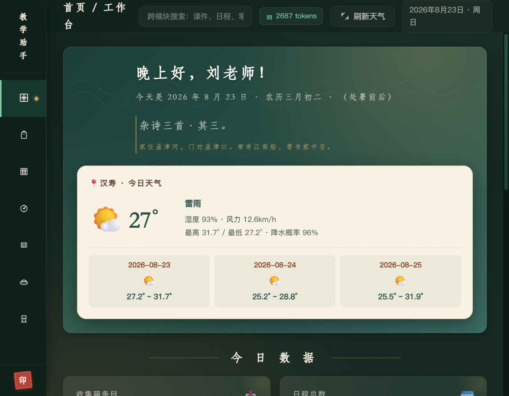](assets/screenshots/home-fullpage.png) | [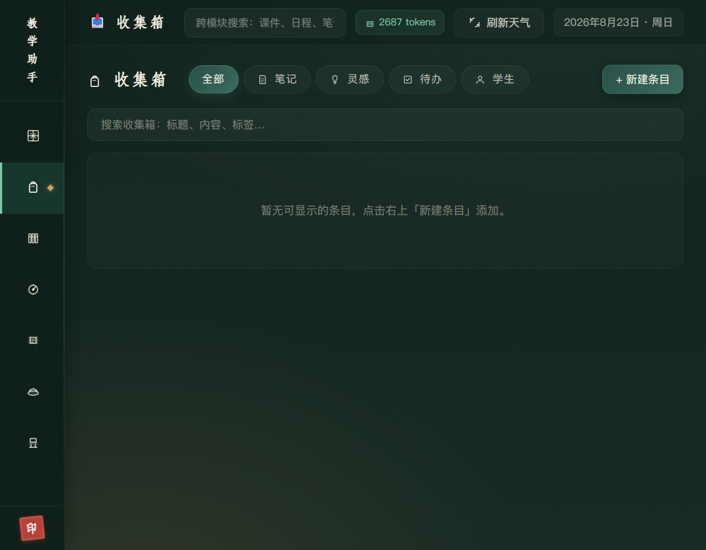](assets/screenshots/inbox-fullpage.png) |

| 📖 阅读 · 知识库 | 📅 日程 |
| :---: | :---: |
| [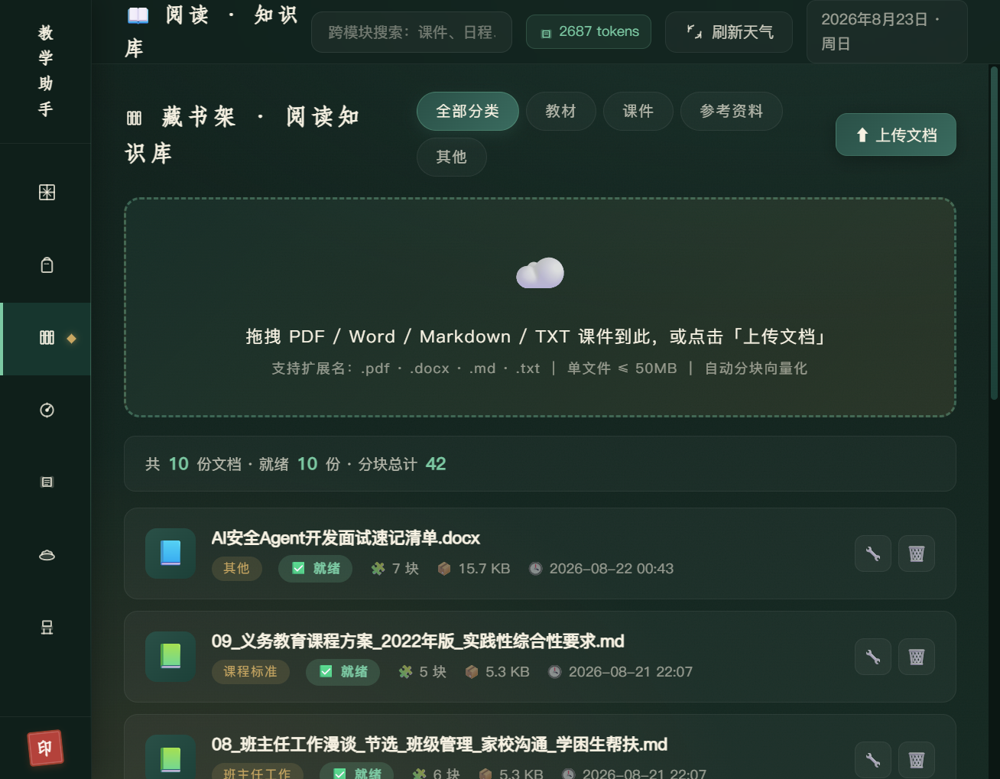](assets/screenshots/reading-fullpage.png) | [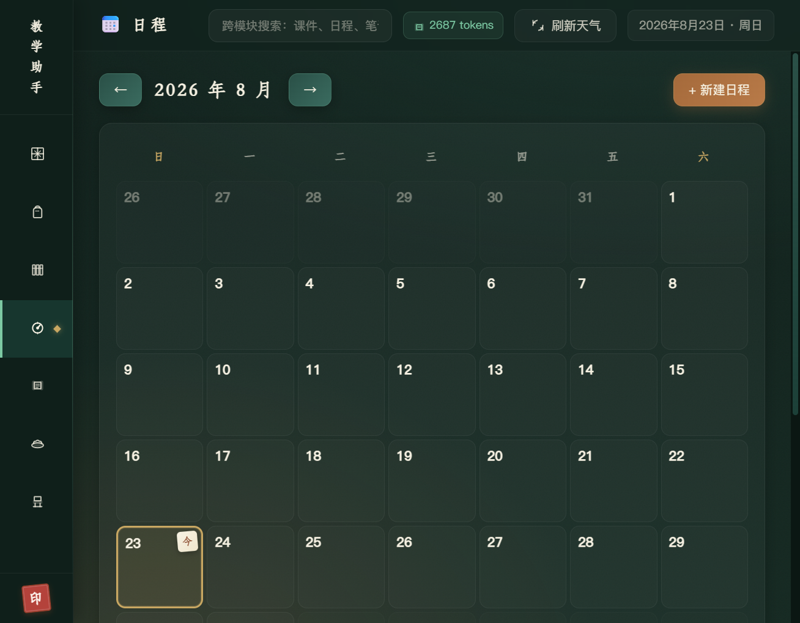](assets/screenshots/schedule-fullpage.png) |

| 🤖 AI 教研助手（RAG + 多模态三面板） | 🛠️ 教学工具（教案 / 课件 / 作业 / 论文 / PPT） |
| :---: | :---: |
| [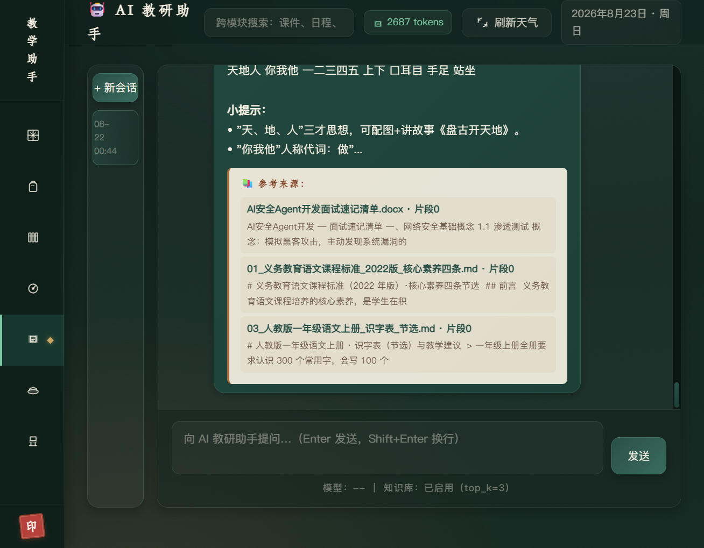](assets/screenshots/ai-fullpage.png) | [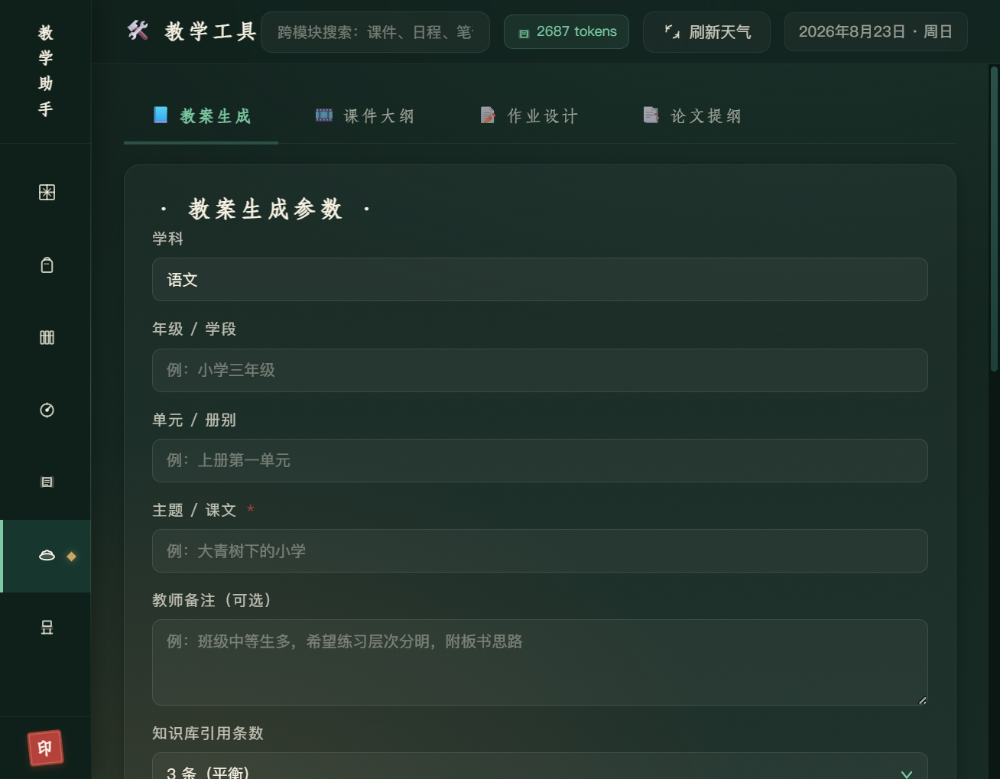](assets/screenshots/tools-fullpage.png) |

| ⚙️ 设置与数据（Key 测试 / Token 统计） |
| :---: |
| [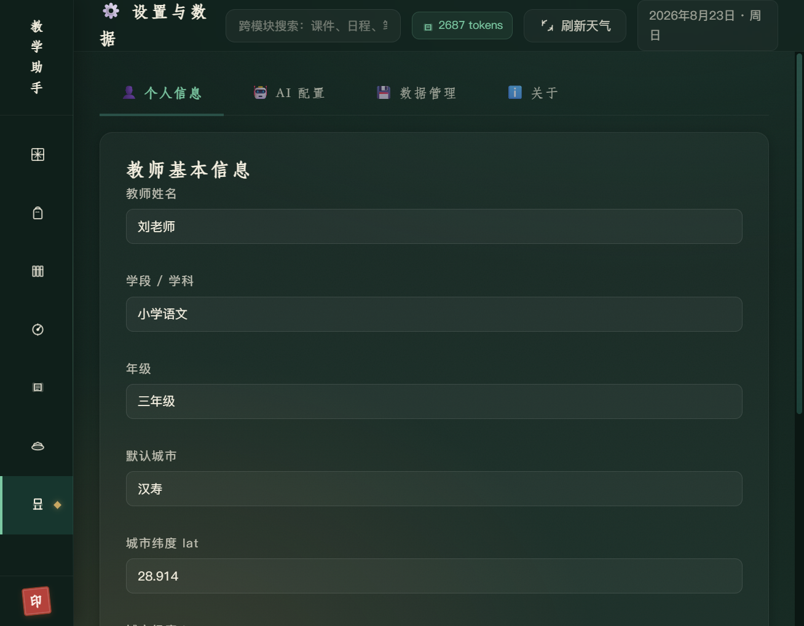](assets/screenshots/settings-fullpage.png) |

***

## 🎞️ PPT 玻璃拟态国风 · 效果演示（v2.4）

> 设计规范：青黛 / 墨蓝 / 茶褐 / 月白 / 朱砂 四色国色板 + 磨砂毛玻璃卡片（半透明、模糊背景、细白描边）+ 宣纸纹理 + 原文+注释双栏玻璃布局 + 逐行淡入动画标记 + **讲者备注原生写入 PPTX**。

| 📋 目录（11 章磨砂玻璃导航卡） | 📖 原文精读（左原文 / 右注释 双栏） |
| :---: | :---: |
| [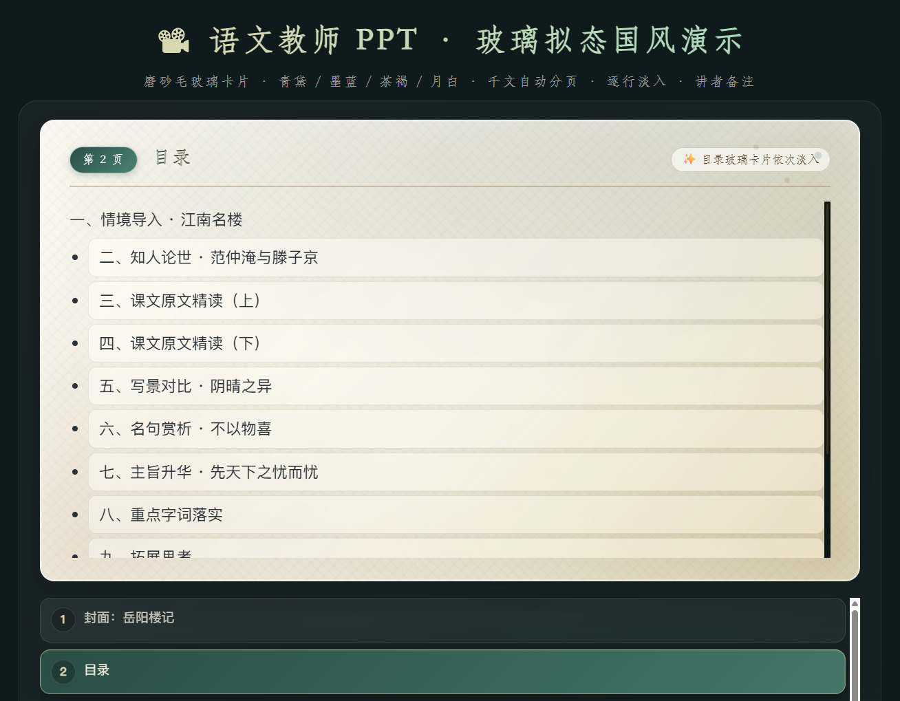](assets/screenshots/ppt-02-toc.png) | [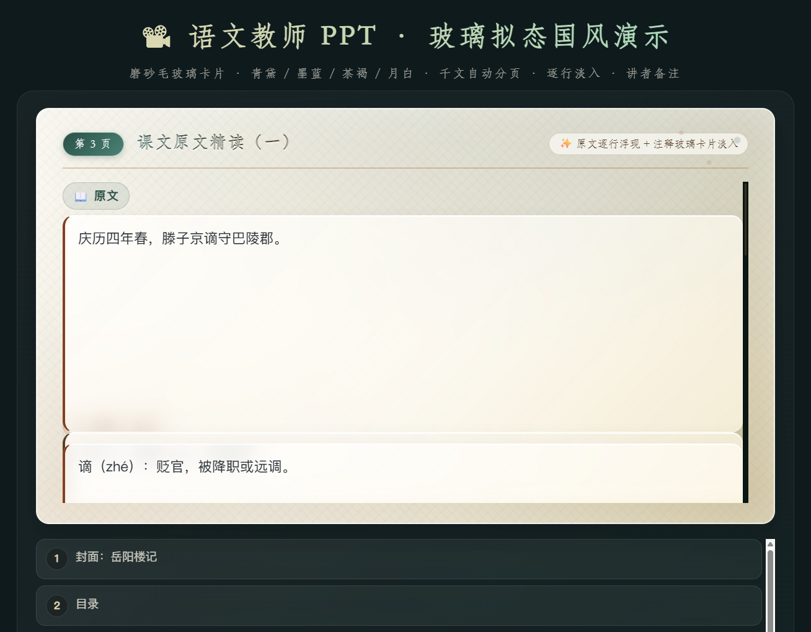](assets/screenshots/ppt-03-text-two-col.png) |

| 🖌 赏析对比（阴晴对比玻璃卡） | 🔖 重点字词（镂空字 + 边框修饰） |
| :---: | :---: |
| [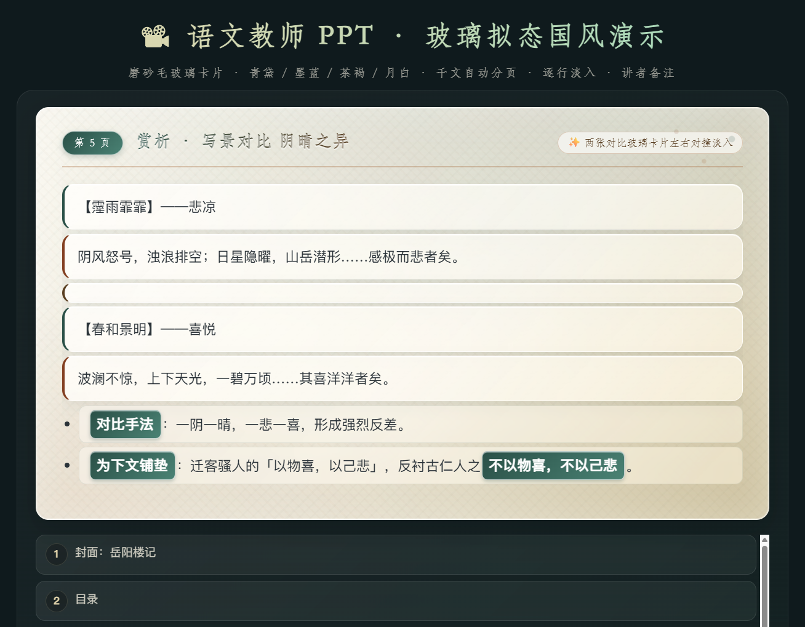](assets/screenshots/ppt-05-analysis-compare.png) | [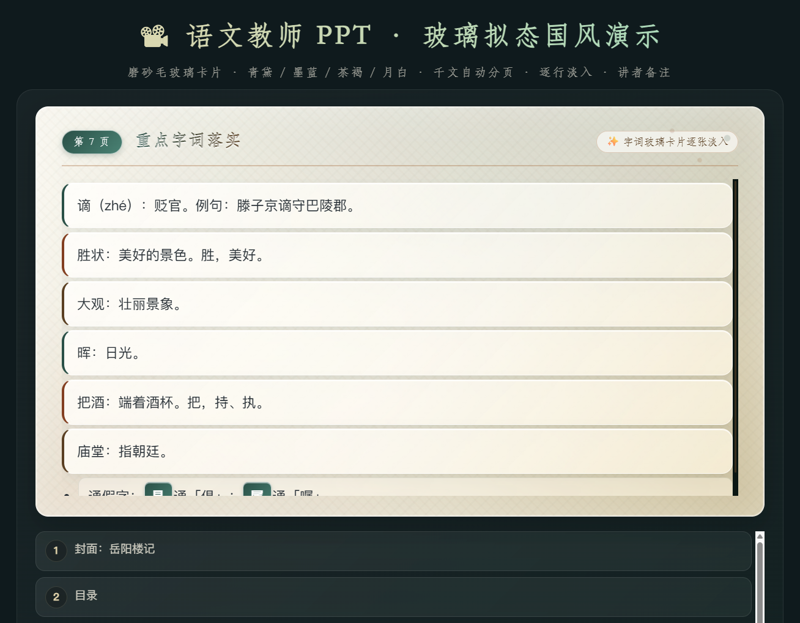](assets/screenshots/ppt-07-keywords.png) |

**PPT 技术要点**：
- 固定 14–20 页结构：封面 / 目录 / 导入 / 原文 2-4 页 / 赏析 3-5 页 / 字词 / 探究 / 小结 / 作业 / 致谢
- `>` = 磨砂玻璃卡片容器；`**粗体**` = 镂空字/边框修饰
- 千文拆分硬约束：每 4–6 句拆一页，名句独立玻璃卡片
- 每页自动写入：讲师备注 / 设计意图 / 动画标记；导出 PPTX 时 **notes 写入放映者视图**

***

## ✨ 项目亮点

### 核心能力

- **🎨 新中式国风 UI**：墨绿/米黄/赭石配色，宣纸纹理，仿宋字体，自研国风 SVG 图标（窗棂、锦囊、竹简、卷轴、印章等 12 枚），2010 首唐诗随机轮换
- **📚 RAG 智能问答**：LangGraph 工作流（retrieve → generate），FAISS 向量检索 + DeepSeek/GLM 生成，参考资料溯源
- **🧠 多模态 AI · 前端三 Tab 面板**：
  - 💬 **文本问答（RAG）**：知识库对话，默认面板
  - 🖼️ **视觉理解 qwen-vl-plus**：批改作业 / 识别教材页面 / 板书分析 / 课堂照片解读
  - 🖌️ **文生图 wanx-v1（通义万相）**：古诗词配图 / 教学卡片插画 / 课堂海报，支持 5 种尺寸
- **🛠️ 教学工具自动生成**：教案 / 课件 / 分层作业 / 教学小论文 / **玻璃拟态国风 PPT**（后端 python-pptx 直出 .pptx，含讲者备注 / 动画标记 / 玻璃圆角形状）

### Token 优化体系

- **score 阈值过滤**：相似度 < 0.30 的 chunk 直接丢弃
- **chunk 文本截断**：单 chunk 注入 prompt 最长 500 字
- **分工具 max\_tokens 调优**：教案=3000 / 课件=2000 / 作业=1500 / 论文=3500 / **PPT=3000**
- **LLM 查询内存缓存**：temperature ≤ 0.5 的相同请求 5 分钟内命中缓存（LRU，上限 200 条）
- **动态 max\_tokens**：AI 对话按问题长度 + 检索 chunk 数动态调整

### 工程 & 部署

- **📊 Token 用量追踪**：后端捕获每次 LLM 调用的 `prompt_tokens / completion_tokens / total_tokens`，前端徽章实时展示，按模型分组统计
- **🪶 轻量部署**：SQLite + 文件系统，零外部依赖；uvicorn 单 worker 内存占用 ~60MB，适合 2 核 2G 服务器
- **🌤️ 双源天气**：主源 Open-Meteo（免 key 全球可用）+ 和风天气兜底
- **🔑 缓存破坏 + Key 归一化**：前端 `?v=` 版本号防缓存，后端 `dashscope_api_key → DASHSCOPE_API_KEY` 自动归一化

***

## 🔮 多模态能力详解（千问 DashScope）

### 1. 视觉问答 · qwen-vl-plus

支持作业照片、教材页面、板书、课堂照片直接发给 AI，返回中文理解与教学建议。

**典型场景**：

- 作业批改：拍照上传学生作业手写页，AI 指出错误 + 给出鼓励评语
- 教材识别：拍下课本一页，AI 提取知识点 + 生成教学要点
- 板书分析：课堂板书照片，AI 整理结构化笔记 + 补充延伸内容

**接口**：

```http
POST /api/ai/vision_chat
Content-Type: application/json

{
  "image_urls": ["https://your-site.com/homework-1.jpg"],
  "prompt": "请批改这张三年级语文作业照片，指出错误并给出鼓励性评语",
  "temperature": 0.5,
  "max_tokens": 1500
}
```

### 2. 文本生图 · wanx-v1（通义万相）

根据课文 / 古诗词 / 活动主题生成国风插画。

**典型场景**：

- 古诗词配图：为《静夜思》《九月九日忆山东兄弟》生成水墨风格插图
- 教学卡片：节日 / 节气主题插画，打印给学生做装饰
- 课堂海报：家长会、读书日、诗词大会主题海报

**接口**：

```http
POST /api/ai/text_to_image
Content-Type: application/json

{
  "prompt": "唐诗《静夜思》配图：月夜窗边，古装儿童仰望明月思念故乡，水墨国风，留白意境",
  "size": "1024*1024",
  "n": 1
}
```

### 3. 配置方法

启动后进入「⚙️ 设置与数据」→ 找到 **DashScope / 千问 Key** → 填入你的 `sk-...` → 测试连通性即可生效。

> 千问 Key 申请：<https://dashscope.console.aliyun.com/>，开通 **qwen-vl-plus** 与 **通义万相（wanx-v1）** 模型即可。

***

## 🛠️ 技术栈

### 后端

- **Web 框架**：FastAPI 0.110+ / uvicorn（单 worker 节省内存）
- **RAG 工作流**：LangGraph StateGraph（retrieve → generate 两节点）
- **Embedding**：智谱 `embedding-3`（2048 维）
- **向量检索**：FAISS IndexFlatIP（L2 归一化 + 内积 = cosine 相似度）
- **LLM 生成**：DeepSeek Chat（主） → 智谱 GLM-4-Flash（兜底） → 千问 qwen-plus（兜底）
- **多模态**：千问 DashScope `qwen-vl-plus`（视觉理解）+ `wanx-v1`（通义万相文生图）
- **存储**：SQLite + 文件系统
- **文档解析**：pypdf（PDF）+ python-docx（Word）+ 原生（TXT/MD）

### 前端

- **纯静态**：原生 HTML + CSS + JavaScript（无构建步骤）
- **国风设计系统**：墨绿 `#2A5047` / 宣纸米黄 `#F7F2E3` / 赭石 `#A56A3B` / 印章红 `#B4423B`
- **字体**：STFangsong / FangSong / SimSun / Noto Serif SC
- **图标**：自研 12 枚国风 SVG
- **数据交互**：fetch API + SSE（流式 AI 回复）

### 部署

- **进程管理**：systemd `teach.service`
- **反向代理**：Nginx `/teach/` → 静态文件，`/teach/api/` → `127.0.0.1:8777`
- **零本地模型**：全部调用云端 API，内存占用极低

***

## 📁 项目结构

```
.
├── backend/                       # 后端（FastAPI）
│   ├── app.py                     # 主入口
│   ├── config.py                  # 全局配置
│   ├── db.py                      # SQLite 封装 + Key 归一化
│   ├── requirements.txt
│   ├── seed_docs.py               # 种子教学文档批量入库
│   ├── routers/
│   │   ├── ai.py                  # 会话 + /ai/ask + SSE + 多模态
│   │   ├── health.py              # 健康检查 + Token 统计 + 缓存
│   │   ├── inbox.py / schedule.py # 收集箱 / 日程 CRUD
│   │   ├── reading.py             # 文档上传 + 向量化 + 重建
│   │   ├── settings.py            # Key 配置 + 连通性测试
│   │   ├── tools.py               # 教学工具（RAG 增强生成）
│   │   └── weather.py             # 双源天气
│   ├── rag/
│   │   ├── embeddings.py          # 智谱 embedding-3
│   │   ├── vectorstore.py         # FAISS 单例 + 持久化
│   │   ├── parser.py              # 文档解析 + 分块（600字 / 100重叠）
│   │   ├── generator.py           # LLM 封装 + 多模态
│   │   └── workflow.py            # LangGraph（retrieve → generate）
│   ├── services/weather.py        # 双源天气服务
│   └── data/documents/             # 10 篇种子教学文档
├── frontend/                      # 前端（纯静态，无构建）
│   ├── index.html                 # 主页面
│   ├── poems.js                   # 2010 首唐诗
│   └── static/app.js + style.css  # 核心逻辑 & 国风样式
├── scripts/                       # 部署脚本与 Nginx 示例
├── assets/screenshots/            # 功能截图
├── docs/
│   ├── HELP.md                    # 教师使用手册
│   ├── LearningText.md            # LangChain/LangGraph/多 Agent 源码解读
│   └── VibeCoding-Journey.md      # Vibe Coding 思路 + 架构决策 + 面试亮点
├── LICENSE                        # MIT
└── README.md
```

***

## 🌐 生产部署（Linux + Nginx + systemd）

### 1. 上传代码到服务器

```bash
scp -r teach-assistant-rag root@your-server:/opt/teach
```

### 2. 安装依赖

```bash
cd /opt/teach/backend
python3.10 -m venv venv
source venv/bin/activate
pip install -r requirements.txt
```

### 3. 创建 systemd 服务

`/etc/systemd/system/teach.service`：

```ini
[Unit]
Description=Teach Assistant RAG Backend
After=network.target

[Service]
Type=simple
User=root
WorkingDirectory=/opt/teach/backend
ExecStart=/opt/teach/backend/venv/bin/uvicorn app:app --host 127.0.0.1 --port 8777 --workers 1
Restart=on-failure
RestartSec=5
Environment=PYTHONUNBUFFERED=1

[Install]
WantedBy=multi-user.target
```

```bash
systemctl daemon-reload
systemctl enable --now teach
systemctl status teach
```

### 4. 配置 Nginx 反向代理

参考 `scripts/nginx-teach-location.conf`，注入到站点配置的 `server { ... }` 块中：

```nginx
location ^~ /teach/ {
    alias /opt/teach/frontend/;
    try_files $uri $uri/ /teach/index.html;

    location ~ ^/teach/api/(.*)$ {
        proxy_pass http://127.0.0.1:8777/api/$1;
        proxy_set_header Host $host;
        proxy_set_header X-Real-IP $remote_addr;
        proxy_set_header X-Forwarded-For $proxy_add_x_forwarded_for;
        proxy_buffering off;           # SSE 流式必需
        proxy_read_timeout 300s;
    }
}
```

```bash
nginx -t && systemctl reload nginx
```

访问 `http://your-server/teach/` 即可。

> ⚠️ Nginx 注意事项：`^~` 确保优先匹配；`alias` 末尾必须有 `/`；`proxy_buffering off` 是 SSE 必需。

***

## 📡 API 速览

所有接口挂载在 `/api` 前缀下（Nginx 转发后为 `/teach/api/`）。

| 模块      | 方法       | 路径                          | 说明                                 |
| ------- | -------- | --------------------------- | ---------------------------------- |
| 健康      | GET      | `/api/health`               | 服务健康检查 + 向量库统计                     |
| 健康      | GET      | `/api/stats/tokens`         | Token 用量统计（总量/按模型/最近 5 条）          |
| 健康      | GET      | `/api/stats/cache`          | LLM 缓存统计（条目数 / TTL）                |
| 健康      | POST     | `/api/cache/clear`          | 清空 LLM 缓存                          |
| 收集箱     | GET/POST | `/api/inbox`                | 收集箱 CRUD                           |
| 日程      | GET/POST | `/api/schedule`             | 日程 CRUD                            |
| 阅读      | POST     | `/api/reading/upload`       | 上传文档（PDF/Word/TXT/MD）              |
| 阅读      | POST     | `/api/reading/rebuild-kb`   | 重建向量库                              |
| AI      | GET/POST | `/api/sessions`             | 会话管理                               |
| AI      | POST     | `/api/ai/ask`               | 同步 RAG 问答                          |
| AI      | GET/POST | `/api/ai/stream`            | SSE 流式 RAG 问答                      |
| 多模态    | POST     | `/api/ai/vision_chat`       | qwen-vl-plus 图文理解                    |
| 多模态    | POST     | `/api/ai/text_to_image`     | wanx-v1 文生图                         |
| 工具      | POST     | `/api/tools/generate`       | 生成教案/课件/作业/论文/PPT（RAG 增强）          |
| 工具      | GET      | `/api/tools/history`        | 工具生成历史                             |
| 设置      | GET/PUT  | `/api/settings`             | 读取/更新设置                            |
| 设置      | POST     | `/api/settings/test-key`    | 测试 API Key 连通性                     |
| 天气      | GET      | `/api/weather`              | 实时天气 + 未来 3 天预报                    |

完整接口文档：启动后访问 `http://localhost:8777/docs`（FastAPI 自动生成的 Swagger UI）。

***

## 🔑 API Key 获取指南

| 服务               | 注册地址                                   | 用途                                                                  | 免费额度             |
| ---------------- | -------------------------------------- | ------------------------------------------------------------------- | ---------------- |
| **DeepSeek**     | <https://platform.deepseek.com>        | 主 LLM（ChatCompletions）                                              | 新用户 500 万 tokens |
| **智谱 AI**        | <https://open.bigmodel.cn>             | Embedding（embedding-3）+ 兜底 LLM（glm-4-flash）                         | 新用户 500 万 tokens |
| **千问 DashScope** | <https://dashscope.console.aliyun.com> | 多模态：qwen-vl-plus（图文理解）+ wanx-v1（通义万相文生图）+ 兜底 LLM qwen-plus        | 新用户百万 token 免费额度 |
| **和风天气**         | <https://dev.qweather.com>             | 天气兜底（必须用 **Web API Key**，不是 SDK 凭据）                                 | 1000 次/天免费       |

> ⚠️ 和风天气 Key 类型：SDK 凭据用于 Android/iOS，调 Web API 会 403；本项目需要 **Web API Key**。
>
> ⚠️ 千问 Key：一个 DashScope Key 同时覆盖 qwen-vl-plus（多模态）、qwen-plus（纯文本）、wanx-v1（文生图）三类能力，进入控制台开通对应模型即可。

***

## 🔒 安全说明

- ✅ 本仓库 **不含任何真实 API Key**：所有 key 在 `config.py` 中默认空字符串
- ✅ `.gitignore` 已排除：`.env`、`*.db`、`*.pkl`、`*.tar.gz`、`__pycache__/` 等
- ✅ Key 存储：SQLite `settings` 表（运行时数据库不入库）
- ✅ Key 读取：优先 DB > 环境变量 > 默认值，支持运行时热加载
- ✅ Key 归一化：`db.py` 中自动将小写键名（`dashscope_api_key` 等）转为大写

***

## 📚 学习资料

- [docs/HELP.md](docs/HELP.md) —— 教师使用手册
- [docs/LearningText.md](docs/LearningText.md) —— LangChain/LangGraph/多 Agent 源码解读 + 国内生态
- [docs/VibeCoding-Journey.md](docs/VibeCoding-Journey.md) —— Vibe Coding 思路梳理 + 架构决策 + 面试亮点

***

## 🧭 Roadmap / 变更记录

### v2.4.0 · PPT 玻璃拟态国风升级

- [x] PPT prompt 全量升级：14–20 页固定结构、千文拆分 4–6 句/页、原文+注释双栏、**讲师备注 / 设计意图 / 动画标记** 三段必填
- [x] 前端 PPT 预览重构：磨砂玻璃卡片 + 镂空字 + 逐行淡入动画 + 青黛/朱砂国色板
- [x] python-pptx 导出重做：玻璃圆角卡片、STFangsong 字体、讲者备注 / 动画标记写入 PPT 原生 notes 视图
- [x] 新增 PPT 玻璃拟态国风截图画廊（目录 / 原文双栏 / 赏析对比 / 重点字词）

### v2.3.0 · 多模态面板 + PPT 演示文稿

- [x] AI 助手多模态三 Tab 面板：文本问答 / 图片理解 / 文生图
- [x] 教学工具新增「生成 PPT」：15–22 页结构化幻灯片，前端翻页预览 + 后端 python-pptx 直出
- [x] 文生图模型名修复：DashScope 合法模型统一为 `wanx-v1`

### v2.2.0 · 千问多模态

- [x] 接入 qwen-vl-plus（图文理解）+ wanx-v1（通义万相文生图）
- [x] 新增 API：`POST /api/ai/vision_chat`、`POST /api/ai/text_to_image`
- [x] API Key 归一化（dashscope_api_key / qwen_api_key / qianwen_api_key → 统一 DASHSCOPE_API_KEY）

### v2.1.0 · Token 优化

- [x] score 阈值过滤（< 0.30 丢弃）、chunk 截断（500 字）、分工具 max\_tokens 调优
- [x] LLM 查询内存缓存（5min TTL / LRU 200）、动态 max\_tokens

### v2.0.0 · 初版

- [x] RAG 增强教学工具、Token 用量追踪、国风 SVG 图标系统、2010 首唐诗、双源天气

### 规划中

- [ ] 多模态支持拖拽上传图片（本地转 Base64 / OSS 上传）
- [ ] PPT 模板市场（星空 / 低多边形 / 山水 / 班级管理 等预设样式）
- [ ] Docker 一键启动 + 内置 mock 模式（不配 Key 也能看完整界面）
- [ ] 多 Agent 路由：视频生成 / 教学动画 / 课堂实录转讲稿

***

## 📄 License

MIT License —— 详见 [LICENSE](LICENSE)。

***

## 🙏 致谢

- [LangGraph](https://github.com/langchain-ai/langgraph) —— Agent 工作流编排
- [FAISS](https://github.com/facebookresearch/faiss) —— 向量检索
- [FastAPI](https://fastapi.tiangolo.com/) —— Web 框架
- [DeepSeek](https://www.deepseek.com/) —— LLM API
- [智谱 AI](https://www.zhipuai.cn/) —— Embedding + LLM
- [千问 DashScope](https://dashscope.aliyun.com/) —— 多模态 qwen-vl-plus + 通义万相文生图
- [Open-Meteo](https://open-meteo.com/) —— 免费天气 API
